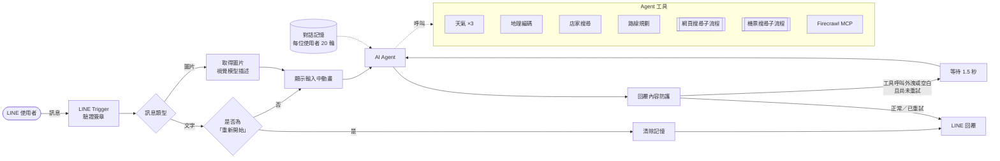
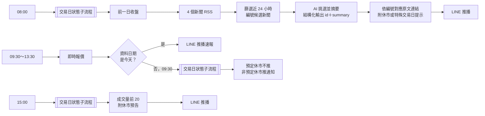

# n8n LINE AI Agent

用 n8n 串接 LINE Messaging API 與大型語言模型，打造一個會「自己挑工具」的 LINE 聊天助理：查天氣、找店家、算路線、查機票、搜尋新聞、看懂圖片，並記得對話脈絡。另外搭配排程推播，每個交易日主動送上台股速報與 AI 整理的財經新聞。

> A LINE chatbot built on n8n: an LLM agent with tool use (Google Weather / Places / Routes, web search, flight search via MCP, image understanding) and per-user conversation memory, plus scheduled Taiwan stock market briefings with AI-curated news.

## 功能一：對話助理（被動回覆）

| 使用者這樣問 | Agent 會呼叫 |
|---|---|
| 「板橋現在天氣如何？」「後天會下雨嗎？」 | Google Weather API：即時天氣、10 天預報、天氣警特報 |
| 「信義區評價高的拉麵」 | Google Places API（評分、營業中、地圖連結） |
| 「台北車站到士林夜市開車要多久？」 | Google Routes API（開車／步行／單車／大眾運輸） |
| 「10/20 台北飛福岡的機票」 | Kiwi.com 官方 MCP Server（子流程） |
| 「今天有什麼颱風消息？」 | SerpAPI Google 搜尋（子流程，附來源網址） |
| 「幫我讀這篇文章」＋網址 | Firecrawl MCP 讀取網頁全文 |
| 傳一張照片或發票 | 視覺模型先描述圖片，再交給主 Agent 回答 |
| 「重新開始」 | 清除該使用者的對話記憶 |

## 功能二：台股速報（主動推播）

以台北時區排程，只在交易日推播；國定假日、颱風等休市日會自動判斷。

| 時間（週一至週五） | 推播內容 |
|---|---|
| 08:00 | 盤前新聞：從經濟日報、自由時報、CNBC、MarketWatch 的近 24 小時新聞中，由 AI 挑出台股、美股各 3 則重點並附原文連結；附前一交易日加權指數與櫃買指數收盤 |
| 09:30～13:30 每小時 | 大盤速報：加權指數、櫃買指數即時點位與漲跌幅 |
| 15:00 | 收盤成交量排行前 20 名；連假前附休市預告 |
| 3、6、9、12 月第三個週一 09:00 | 0050 成分股季度調整提醒 |

交易日判斷邏輯：
- **預定休市**：子流程查詢證交所休市日 API，平日休市時 08:00 推一則休市通知，其他時段不推。
- **非預定休市（颱風等）**：休市日 API 查不到，改看即時報價的資料日期。資料停在前一交易日就代表今天沒開盤，09:30 推一次通知。
- **特殊交易日**：農曆春節前最後交易日（封關）、春節後第一個交易日（開紅盤）會在新聞訊息中附上提示。

## 架構：對話助理



## 架構：台股速報



## 專案結構

```
workflows/
├── line-ai-chatbot.json             # 對話助理主流程：LINE 收發、AI Agent、記憶、工具
├── subworkflow-web-search.json      # 子流程：SerpAPI 搜尋並整理成「標題＋網址」
├── subworkflow-flight-search.json   # 子流程：呼叫 Kiwi.com MCP 查機票並整理結果
├── stock-alert.json                 # 台股速報：4 組排程（新聞、盤中、成交量、換股提醒）
└── subworkflow-tw-trading-day.json  # 子流程：查詢證交所休市日，回傳交易日狀態與休市預告
```

## 技術棧

- **n8n**（自架，2.x；以 2.40 開發測試）
- **LLM**：OpenRouter。對話助理使用 `openai/gpt-5.6-luna-pro`（需支援工具呼叫與圖片輸入），新聞摘要使用 `google/gemini-3.1-flash-lite`，皆可替換
- **n8n AI 節點**：AI Agent、Simple Memory、Chat Memory Manager、Tool Workflow、HTTP Request Tool、MCP Client
- **外部服務**：LINE Messaging API、Google Weather / Geocoding / Places (New) / Routes API、SerpAPI、Kiwi.com MCP、Firecrawl MCP、臺灣證券交易所 OpenAPI 與即時報價、財經新聞 RSS

## 安裝與匯入

### 1. 事前準備

- 一個可從外網連入的自架 n8n（LINE webhook 需要 HTTPS 公開網址，可用 ngrok、Cloudflare Tunnel、Tailscale Funnel 等）
- 安裝社群節點（Settings → Community Nodes）：
  - `@aotoki/n8n-nodes-line-messaging`：LINE 觸發、回覆、輸入中動畫、取得圖片
  - `n8n-nodes-serpapi`：SerpAPI 搜尋
- 在 LINE Developers 建立 Messaging API channel，取得 **Channel access token** 與 **Channel secret**

### 2. 建立憑證

| n8n 憑證類型 | 用途 | 設定 |
|---|---|---|
| LINE Messaging API | 收發 LINE 訊息 | Channel access token、Channel secret（用於驗證簽章） |
| OpenRouter API | LLM | API key |
| Query Auth | Google Weather、Geocoding | Name 填 `key`，Value 填 Google API key |
| Header Auth | Google Places、Routes | Name 填 `X-Goog-Api-Key`，Value 填 Google API key |
| SerpAPI | 網頁搜尋 | API key |

Google Cloud 專案需啟用 Weather API、Geocoding API、Places API (New)、Routes API。Kiwi.com 與 Firecrawl 的 MCP 端點不需金鑰。

### 3. 匯入 workflow

1. 先匯入兩個子流程，並各自**發布（Publish）**：n8n 2.x 的子流程要發布後才能被呼叫。
2. 再匯入 `line-ai-chatbot.json`。
3. 在主流程中：
   - 開啟「kiwi 機票資訊查找」「網頁資訊查找」兩個工具節點，重新選取剛匯入的子流程（匯入後 workflow ID 會不同）。
   - 為每個節點選取你建立的憑證。
4. 發布主流程，複製「Line Messaging Trigger」的 **Production URL**。
5. 回到 LINE Developers：Webhook URL 貼上該網址、開啟 **Use webhook**，並在 LINE Official Account Manager 關閉自動回應訊息。

### 4. 台股速報（選用）

1. 先匯入 `subworkflow-tw-trading-day.json` 並發布，再匯入 `stock-alert.json`。
2. 開啟三個「取得交易日狀態」節點（B-、C-、D- 開頭），重新選取剛匯入的子流程。
3. 把所有 LINE 推播節點的收件者 `YOUR_LINE_USER_ID` 換成你的 LINE userId：
   - 在 LINE Developers 的 channel 頁面 **Basic settings → Your user ID** 可以查到自己的 userId（`U` 開頭的 33 碼字串）。
   - 推播用的是 push message，會計入 LINE 官方帳號的每月免費訊息額度。
4. 為 LINE 與 OpenRouter 節點選取憑證後發布。證交所 API 與 RSS 不需金鑰。

## 設計重點

- **工具描述就是提示詞**：模型只靠工具名稱與描述決定要不要呼叫。每個工具都寫明適用與不適用的情境（例如天氣工具只能查單一地點，「全台哪裡下雨」要改用搜尋），並在 system prompt 依回應速度排出工具優先順序，把最慢的 Firecrawl 全文讀取放最後。
- **HTTP Request Tool 用英文命名**：n8n 以節點名稱產生 LangChain 工具名稱，純中文名稱會被清成 `_`，造成「multiple tools with the same name」錯誤。
- **避開 n8n 巢狀 `$fromAI` 的已知問題**（[n8n#13947](https://github.com/n8n-io/n8n/issues/13947)）：Routes API 的請求 body 巢狀很深，改為讓模型一次產生整個 JSON（單一 `$fromAI(..., 'json')`）。
- **日期由程式換算，不讓模型猜**：Google Weather 的「一天」是當地早上 7 點起算。天氣預報工具只請模型給目標日期，天數由 n8n 表達式計算，避免凌晨查詢時天數算錯而重打 API。
- **回覆內容防護**：偵測模型把工具呼叫文字外洩到回覆、或回覆空白時，等待 1.5 秒重試一次，仍失敗就回覆固定的道歉訊息，不會把錯誤內容傳給使用者。
- **圖片先轉文字**：圖片交給獨立的視覺 Agent 描述（要求逐字核對數字、看不清楚就標註），主 Agent 與對話記憶只處理文字。
- **配合 LINE 的限制**：輸入中動畫設為 60 秒，對齊 replyToken 約 60 秒的效期；回覆不使用 markdown，網址保持純文字才能點擊。
- **新聞連結不交給模型產生**：候選新聞先編號，模型只回傳「編號＋摘要」的結構化 JSON，程式再依編號對應原文標題與連結，模型無法捏造網址。也刻意不使用輸出解析器的自動修正（修正模型看不到原始新聞，輸出壞掉時會編造內容），改為失敗重試一次，仍失敗就推保底訊息。
- **交易日判斷抽成子流程**：新聞、盤中、成交量三組排程共用同一個「交易日狀態」子流程，休市邏輯只維護一份。
- **安全**：Trigger 以 Channel secret 驗證 `X-Line-Signature`（HMAC-SHA256），偽造或缺少簽章的請求會直接被拒絕，不會觸發 AI；所有金鑰都存在 n8n 憑證中，匯出的 JSON 只含憑證名稱參照。

## 已知限制

- 目前只處理文字與圖片訊息，貼圖、語音、位置等類型尚未支援。
- Simple Memory 存在 n8n 記憶體中，n8n 重新啟動後對話記憶會清空。
- Google Weather API 採國家白名單制：台灣全部支援，部分國家（例如日本）只支援天氣警特報。
- 證交所休市日 API 只提供當年度資料，跨年時可能查不到隔年的休市日；盤中速報另有「資料日期」檢查作為保險。

## 後續規劃

- 會議記錄助理：上傳錄音檔 → 逐字稿與說話者辨識 → 自動整理成會議記錄
- 主動推播：中央氣象署颱風、地震、天氣特報
- 行事曆與記事：Google Calendar、n8n Data Table
- 錯誤通知：workflow 失敗時主動推播給管理者

## 授權

[MIT](LICENSE)
